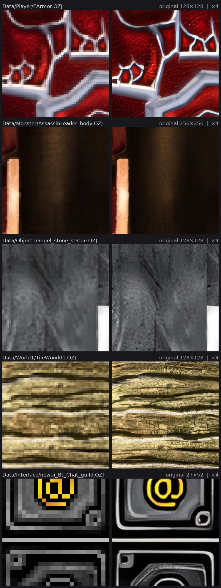

# MuMain Upscaled Textures

*[Wersja polska](Readme.pl.md)*

Upscaled textures for the [MuMain](https://github.com/sven-n/MuMain) game client:
7388 OZJ/OZT files from the client's `Data/` folder, 7271 of them at ×4 and 117 at ×2.
They cover the world, monsters, players, items, effects and the UI. The repository is
an overlay: it holds only the upscaled files, and the client keeps using its own
copies of everything else.

*Left: the original texture, enlarged with no smoothing. Right: the upscaled file.*

## Requirements

The client has to recognise the scale marker in these files (MuMain PR 718) and
support texture packs in `Data/TexturePacks/` (MuMain PR 763). A client without
the marker draws every texture several times too large. A client with the marker
but without texture packs ignores this pack; for it, use release v1.0, whose files
overwrite those in `Data/`.

The textures are made from the original game files in MuMain's `Data/` folder.
World, model and effect textures do not depend on the UI. The `Interface/`
textures are drawn by both RmlUi themes (`legacy` uses most of them, `modern` fewer)
and by the parts of the UI not yet moved to RmlUi.

## Installing

1. Download the archive from [Releases](../../releases), or clone the repository.
2. Copy its `Data/` folder into the client folder, next to `Main` / `Main.exe`.
   The textures land in `Data/TexturePacks/Upscaled/` and no original file is
   overwritten.
3. In the game's options, **Interface** tab, choose `Upscaled` under
   **Texture Pack** and restart the game.

To go back to the original textures, choose **Original** there and restart the
game. The folder can then be deleted.

The upscaled files take about 2.8 GB on disk and need correspondingly more video
memory than the originals.

## How it works

The first four bytes of an OZJ or OZT header are unused by the client. Here they
hold the marker `M` `U` `X` followed by the scale (2 or 4). A client that knows the
marker uploads the full image but keeps the original size as the texture size, so
terrain, models and UI layouts stay as they were. The upscaled textures also get
mipmaps and trilinear filtering, so their detail does not shimmer at a distance.

For each texture the client reads the copy in the active pack when there is one
and the original from `Data/` otherwise. Files without the marker load as before,
so original and upscaled files can be mixed freely, for example to keep the
original UI by deleting `Data/TexturePacks/Upscaled/Interface/`.

## What is not upscaled

93 files stay original: canvases the client draws into, terrain lighting, files
too large for the client's 1024 px limit and files the upscaler cannot read.
The full list with reasons is in [docs/not-upscaled.md](docs/not-upscaled.md).

## How the textures were made

Each file was decoded, upscaled with an ESRGAN model and written back in its
original format, with the marker added:

- **World, models, effects, items** (6406 files): `4x-UltraSharp` by Kim2091.
- **UI** (`Interface`, `Logo`, `Local`, `InGameShopBanner`, 982 files):
  `4x_foolhardy_Remacri` by FoolhardyVEVO.

Files that would exceed 1024 px at ×4 were upscaled ×2 instead.

## License

The original textures are part of the MU Online client by Webzen. These files are
derived from them and are not open source. Both upscaling models are licensed
under CC BY-NC-SA 4.0, so no commercial use. Details in [NOTICE](NOTICE).

Original author: [Nolt](https://github.com/nolt).
